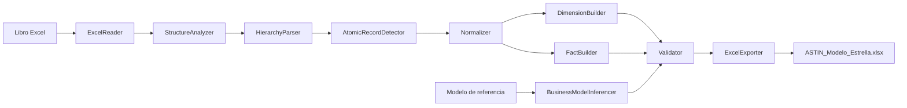

# Arquitectura del MVP

Cada componente tiene una única responsabilidad. `NormalizationPipeline` sólo orquesta el flujo y la interfaz Tkinter sólo recoge acciones del usuario y presenta su resultado.
